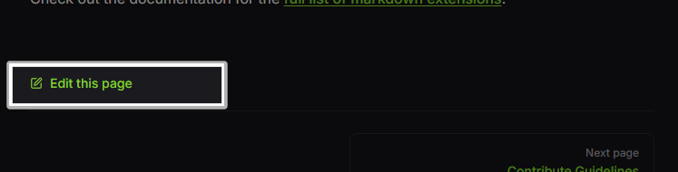
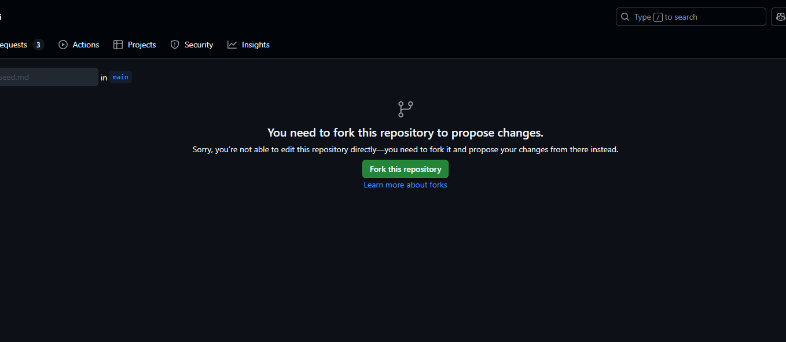
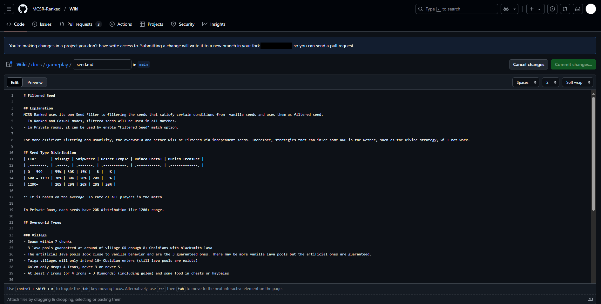
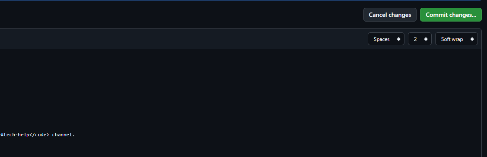
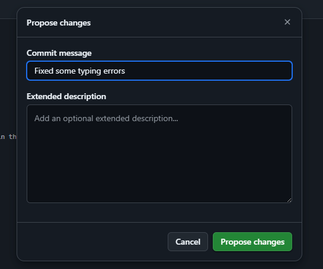
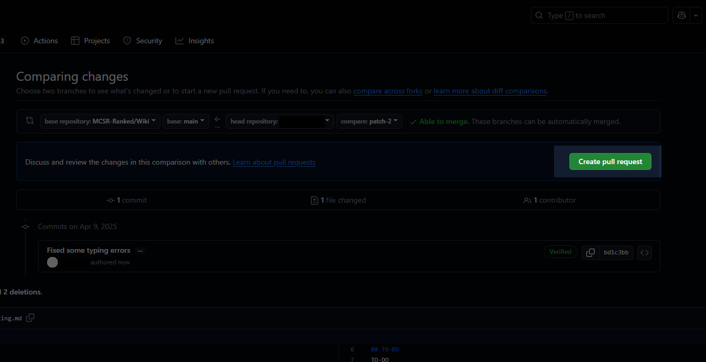
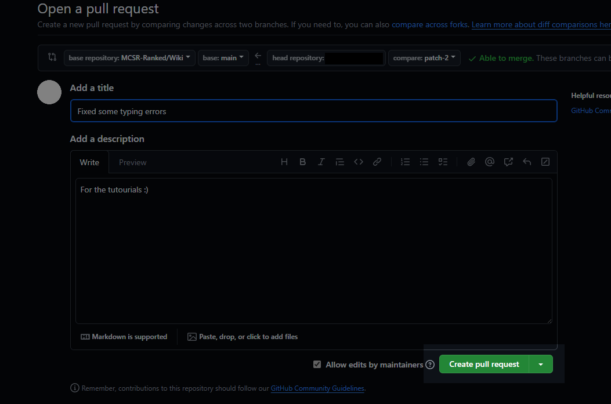

# Edit the Page

## Pull Request
If you know how to use GitHub, you can edit the documentation while following the guidelines and make a Pull Request.

If you don't know how to use GitHub, follow the steps below:

## Starting with Edit

At the bottom of each page, there is an "Edit the page" button. Click that button. 
If you are not already logged in to GitHub, you will be taken to a login page. Just login :)

### First Time Edit

If it's your first time editing the page, you will see this page. In this case, click "Fork this repository" in the middle.

### Edit the page

You can now edit the content of the page. Click "Preview" on the top left of the editor to see how the content will appear on the page. Available formatting options can be seen [here](./#markdown-format).

---

### Create an Edit Request

When you are done with editing, click "Commit changes..." on the top right of the editor.

---

Then you will see this window. 
In the "Commit message," you have to title your edit request. The title should make it easy to understand what your change is. You can add a more detailed description in the second box 
When done, click "Propose changes."

---

Finally, click "Create Pull Request." 

---

Now, it's done. You will have to wait for the review before your change gets applied to the page. 
If you want to see the review process, see [this next document](./review) :)
