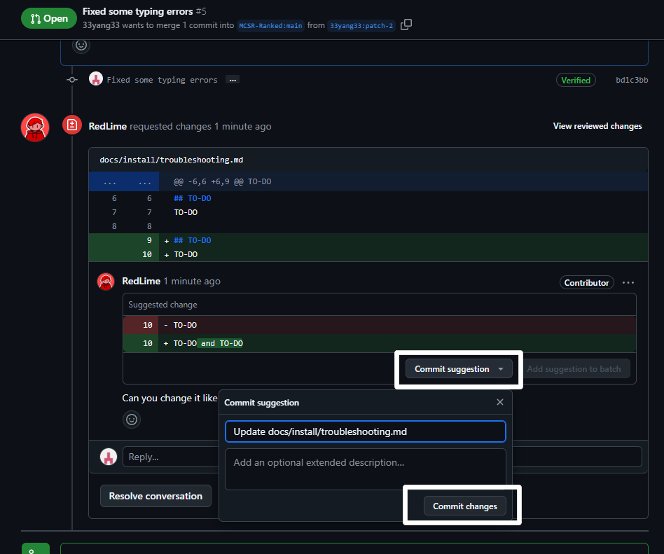
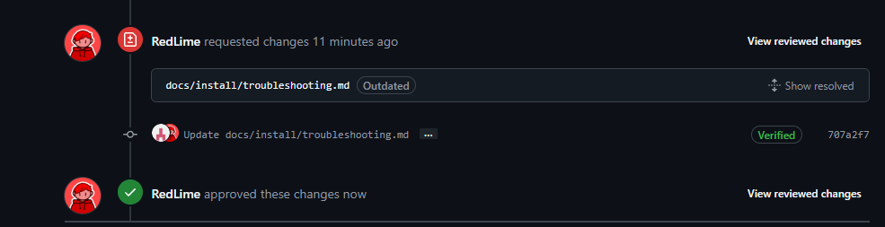

# Request Reviews

After you create the pull request, a maintainer will review it.

If there are no issues, it will be applied to the page. In some cases, you may be asked to change specific parts.

---

You can apply the suggestion to your request. If you don't agree with the suggestion, leave a comment or discuss it in the [Discord server](https://discord.mcsrranked.com).

---

If you get approval from the maintainers, your changes will be applied to the page!
